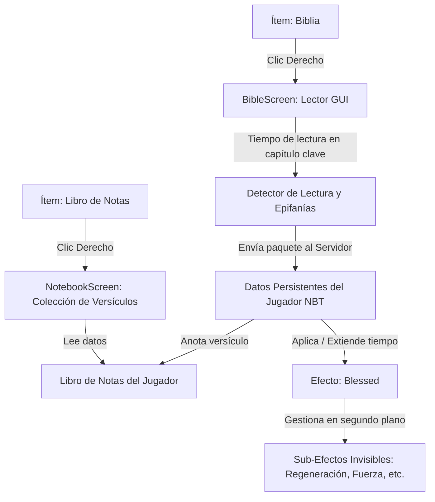

# Documento de Diseño: Mod "Spirit" 📖✨
> **Minecraft 1.21.1 | NeoForge 21.1.250 | Java 21**  
> *Autor: Fernando Ortiz*

---

## 1. Visión General del Proyecto

**Spirit** es un mod inmersivo que transforma la Santa Biblia dentro de Minecraft en una fuente viva de conocimiento, devoción y recompensas espirituales para el jugador.

En lugar de otorgar efectos al azar, el mod premia la **lectura consciente y el descubrimiento**: a medida que el jugador lee pasajes específicos de las Escrituras que tratan sobre sanidad, fortaleza, protección o provisión, el juego reconoce esa "revelación" (*Epifanía*), desbloqueando dones espirituales bajo el estado unificado **`Blessed`** y registrándolos en un **Libro de Notas (Diario Espiritual)**.

---

## 2. Mecánicas Centrales de Juego

### 2.1. Detección de Pasajes Clave (Epifanías)
A lo largo de los 66 libros de la Biblia existen versículos específicos con una profunda promesa bíblica.
Cuando el jugador está leyendo la Biblia en la pantalla interactiva (`BibleScreen`) y se posa sobre uno de estos capítulos durante un tiempo mínimo de lectura reflexiva (por ejemplo, 5 a 10 segundos):
1. Suena un tintineo celestial sutil (*sonido ambiental*).
2. Aparece un mensaje en la barra de acción (*Action Bar*):  
   `✨ Has recibido la revelación de Isaías 53:5: Sanidad Divina`
3. El versículo queda **descubierto de forma permanente** en la memoria del jugador y se anota automáticamente en su **Libro de Notas**.

---

### 2.2. El Estado "Blessed" y el Apilamiento de Dones (*Stacking*)

El estado **`Blessed`** actúa como un **Efecto Paraguas (Umbrella Effect)**:
- **Pantalla limpia:** En el HUD y en el inventario del jugador, solo se muestra el icono dorado de **`Blessed`**. Los efectos secundarios no ensucian la pantalla con 5 iconos distintos.
- **Acumulación de tiempo:** Cada versículo clave descubierto o releído añade tiempo a `Blessed` (por ejemplo, **+5 minutos**).
- **Acumulación de dones:** Cada pasaje añade su don a la lista de bendiciones activas sin perder las anteriores:
  - *Lees Isaías 53:5* $\rightarrow$ `Blessed I` (5 min) con **Regeneración I**.
  - *Luego lees Filipenses 4:13* $\rightarrow$ `Blessed I` (tiempo aumentado a 10 min) con **Regeneración I + Fuerza I**.
  - *Luego lees Isaías 43:2* $\rightarrow$ `Blessed I` (tiempo aumentado a 15 min) con **Regeneración I + Fuerza I + Resistencia al Fuego I**.

---

### 2.3. Rango de Devoción: Blessed I vs Blessed II

El crecimiento espiritual lleva tiempo. El mod evalúa dos parámetros persistentes por jugador:
1. **Tiempo total de lectura acumulado:** Cada minuto que el jugador pasa leyendo en la Biblia se suma a su historial permanente.
2. **Cantidad de versículos clave descubiertos en su Libro de Notas.**

| Nivel | Requisito de Devoción | Beneficio |
| :--- | :--- | :--- |
| **Blessed I** | Inicial | Dones en Nivel I (*Fuerza I, Regeneración I, Prisa I...*). |
| **Blessed II** | 2+ horas (120 min) acumuladas de lectura y al menos 15 versículos descubiertos | Todos los dones activos escalan a **Nivel II** (*Fuerza II, Regeneración II, Resistencia al Fuego II...*). |

---

## 3. Catálogo de Versículos y Dones Bíblicos

| Pasaje Bíblico | Texto Clave | Don Otorgado | Efecto Minecraft |
| :--- | :--- | :--- | :--- |
| **Isaías 53:5** | *«...y por su llaga fuimos nosotros curados.»* | **Sanidad Divina** | Regeneración |
| **Filipenses 4:13** | *«Todo lo puedo en Cristo que me fortalece.»* | **Fuerza Celestial** | Fuerza (*Damage Boost*) |
| **Isaías 43:2** | *«Cuando pases por el fuego, no te quemarás...»* | **Protección del Horno** | Resistencia al Fuego |
| **Salmos 91:11-12**| *«A sus ángeles mandará cerca de ti... para que tu pie no tropiece.»* | **Pies de Cierva** | Caída de Pluma (*Slow Falling*) |
| **Salmos 90:17** | *«Y la obra de nuestras manos confirma sobre nosotros.»* | **Diligencia** | Prisa Minera (*Haste / Dig Speed*) |
| **Salmos 119:105**| *«Lámpara es a mis pies tu palabra, y lumbrera a mi camino.»* | **Luz Verdadera** | Visión Nocturna |
| **Deuteronomio 28:8**| *«Jehová mandará la bendición... en tus graneros y en tu mano.»*| **Gracia y Fortuna** | Suerte (*Luck*) |
| **Juan 6:35** | *«El que a mí viene, nunca tendrá hambre...»* | **Pan de Vida** | Saturación |
| **Salmos 91:1-4** | *«Con sus plumas te cubrirá, y debajo de sus alas estarás seguro.»* | **Amparo del Altísimo**| Resistencia |
| **Isaías 40:31** | *«...levantarán alas como las águilas; correrán y no se cansarán.»* | **Renovación** | Velocidad |

---

## 4. Nuevo Objeto: El "Libro de Notas" (Diario Espiritual)

### 4.1. Concepto
Un cuaderno encuadernado que el jugador lleva en su inventario para consultar sus descubrimientos.
- **Receta de Crafteo:** 1 Libro + 1 Pluma + 1 Tinte Dorado/Amarillo (o Lapislázuli).
- **Interfaz Gráfica (`NotebookScreen`):**
  - Muestra una lista elegante de todos los versículos descubiertos.
  - Cada entrada muestra:
    - Referencia (*ej: Isaías 53:5*).
    - El versículo bíblico completo.
    - El Don asociado (*ej: Regeneración I / II*).
    - Estado actual: **ACTIVO** (en verde si `Blessed` lo está aplicando) o **INACTIVO**.
  - Los versículos no descubiertos aparecen con signos de interrogación (`??? - Oculto en las Escrituras`) para incentivar la exploración de toda la Biblia.

---

## 5. Arquitectura Técnica de Código

### Componentes de Software a Desarrollar:

1. **`EpiphanyRegistry`**:
   - Diccionario estático que mapea: `(Libro, Capítulo, Versículo) -> Don Espiritual`.
2. **`PlayerDevotionData` (Persistencia NBT)**:
   - Guarda en el jugador:
     - `discoveredVerses`: Conjunto (`Set<String>`) con los IDs de versículos leídos.
     - `totalReadingSeconds`: Segundos totales acumulados en la Biblia.
     - `activeBlessings`: Lista de dones que componen el estado `Blessed` actual.
3. **`BlessedEffect` (Efecto de Poción)**:
   - Mantiene activos los sub-efectos con `showIcon: false` y `visible: false`.
   - Controla el escalado a Nivel 2 según la devoción del jugador.
4. **`NotebookItem` y `NotebookScreen`**:
   - Ítem y pantalla del diario de versículos descubiertos.
5. **Red / Paquetes NeoForge (`Networking`)**:
   - Notifica al servidor cuando el jugador pasa tiempo suficiente leyendo un capítulo clave para otorgar la bendición de forma segura.

---

## 6. Hoja de Ruta de Implementación (Paso a Paso)

- [x] **Fase 1:** Motor de lectura de la Biblia en JSON (66 libros, ortografía limpia, navegación y pantalla con scroll).
- [ ] **Fase 2:** Crear la estructura de datos de las Epifanías (`EpiphanyRegistry`).
- [ ] **Fase 3:** Registrar el efecto de estado `Blessed` en NeoForge (`Spirit.java`).
- [ ] **Fase 4:** Sistema de persistencia NBT del jugador (guardar versículos descubiertos y tiempo de lectura).
- [ ] **Fase 5:** Conectar la pantalla `BibleScreen` para detectar la lectura de versículos clave y aplicar `Blessed` acumulativo.
- [ ] **Fase 6:** Crear el ítem y la interfaz del **Libro de Notas** para ver los versículos descubiertos y sus dones activos.
