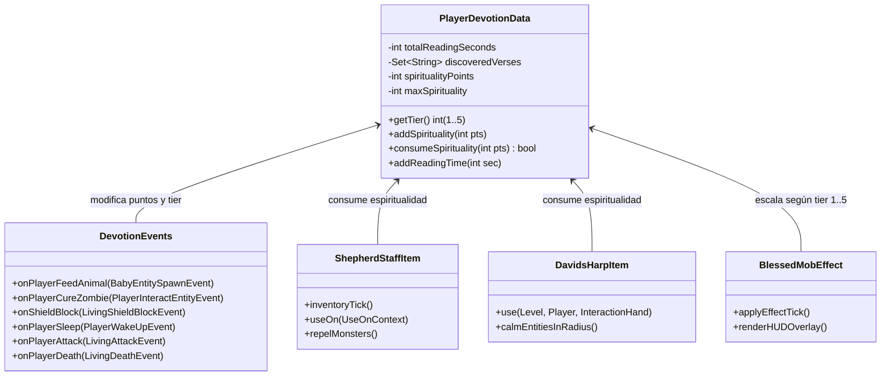

# 🕊️ Sistema de Progresión y Devoción: Blessed I a V
> **Mod "Spirit" — NeoForge 1.21.1 (Minecraft Java Edition)**  
> *Documento de Diseño de Experiencia de Juego (GDD) y Arquitectura Técnica*

---

## 1. Filosofía de Diseño: Experiencia de Juego y Espiritualidad Viva

El objetivo fundamental de esta actualización es transformar la lectura bíblica y la fe dentro del juego en un **ciclo de juego dinámico, orgánico y gratificante**, evitando a toda costa el "grindeo AFK" o la lectura forzada e interminable:

1. **La Palabra como Refugio, no como Castigo:** Leer la Biblia debe sentirse como un descanso reconfortante entre viajes a la mina o expediciones peligrosas. Los hitos de tiempo están calibrados para acompañar naturalmente la vida del jugador.
2. **Acciones Nobles en el Mundo:** La fe se demuestra con obras. Cuidar la creación, alimentar animales, sanar a aldeanos y convivir en paz premia al jugador con energía espiritual.
3. **Poder con Sentido Bíblico:** Las habilidades no son magia genérica ni poderes destructivos; son actos de protección, provisión, consuelo, pastoreo e intercesión.

---

## 2. La Escala de Devoción: Rangos Blessed I a Blessed V

La progresión se calibra en **5 niveles armónicos**, combinando tiempo de lectura acumulado y versículos clave descubiertos en el Diario Espiritual:

| Rango | Título Espiritual | Requisito de Lectura | Versículos Mínimos | Capacidad Máx. Espiritualidad | Temática y Rol |
| :---: | :--- | :---: | :---: | :---: | :--- |
| **I** | **Iniciado en la Gracia** | Inicial (0 min) | 1 versículo | **100 pts** | Primer contacto con la Palabra y paz interior. |
| **II** | **Caminante de la Fe** | **15 minutos** | 5 versículos | **250 pts** | Cuidado de la creación, pastoreo y provisión básica. |
| **III** | **Siervo Constante** | **40 minutos** | 12 versículos | **500 pts** | Consagración del hogar, santuario y apaciguamiento. |
| **IV** | **Discípulo Probado** | **1 hora 10 min (70m)** | 25 versículos | **800 pts** | Victoria espiritual: defensa divina, agua y firmeza. |
| **V** | **Lleno del Espíritu Santo** | **2 horas (120m)** | 40 versículos | **1200 pts** | Milagros supremos: multiplicación y resurrección. |

---

## 3. Mecánica del Recurso: Puntos de Espiritualidad (Gracia Activa)

La **Espiritualidad** es la reserva interior de fe del jugador. Se representa con una sutil hilera de pequeñas palomas doradas sobre la barra de experiencia (o integrado en la pestaña de Bendiciones del inventario).

### 3.1. Cómo se Gana Espiritualidad (Obras de Amor y Devoción)
Para evitar que los jugadores dejen la pantalla abierta sin jugar o se queden inmóviles frente a un atril, la espiritualidad se genera por **acciones vivas en el mundo**:

* **Lectura Consciente de la Biblia:** +1 punto cada 15 segundos mientras se leen nuevos capítulos (máximo 60 puntos por sesión para incentivar salir a vivir la fe).
* **Alimentar / Aparear Animales Pacíficos:** +5 puntos (cuidado y bendición de la creación animal).
* **Sanar a un Aldeano Zombi (Purificación):** +40 puntos (obra mayor de redención y compasión).
* **Curar o Alimentar a otro Jugador:** +10 puntos (compartir pan o pociones saludables con alguien con poca vida).
* **Cosechar y Replantar Cultivos:** +1 punto cada 4 semillas resembradas (mayordomía agradecida de la tierra).
* **Presencia en el Atril Sagrado:** +1 punto cada 45 segundos si el jugador está dentro de su radio (lento, pasivo, de fondo).
* **Pan de Cada Día (Amanecer en Paz):** +15 puntos al despertar de una noche sin haber causado daño.

### 3.2. Pérdida de Espiritualidad (Transgresiones y Crueldad)
Las malas acciones marchitan el estado espiritual del jugador:
* **Atacar a otro jugador inocente (PvP agresivo):** -30 puntos.
* **Matar crías de animales o aldeanos pacíficos:** -50 puntos.
* **Comer Carne Podrida u Ojos de Araña (Carroña impura):** -15 puntos.
* **Destruir un Atril Sagrado con la Biblia montada:** -100 puntos y suspensión temporal del aura de paz.
* *Nota:* Si la espiritualidad llega a 0, los milagros activos no pueden invocarse hasta meditar u orar con una obra de bien.

---

## 4. Árbol de Habilidades y Milagros por Nivel

### 🕊️ RANGO I: Iniciado en la Gracia (0 min | 1 versículo)
*Enfocado en la paz inicial y la constancia de leer.*
1. **Pan de Cada Día (Pasiva):** Al despertar de una cama o conectarse cada día, aparece en el chat un versículo inspirador en color dorado y se recibe el efecto de regeneración leve durante 30 segundos.
2. **Presencia Pacífica (Pasiva):** Animales tímidos (conejos, ocelotes) no huyen tan rápido cuando te acercas despacio.

---

### 🌿 RANGO II: Caminante de la Fe (15 min | 5 versículos)
*Enfocado en la armonía con la naturaleza y el cuidado de los alimentos.*
1. **El Cayado del Pastor (Herramienta Sagrada):**
   * *Mecánica:* Crafteo de un bastón de madera noble con un toque de oro. Al sostenerlo en la mano principal, las ovejas, vacas y cerdos cercanos te siguen pacíficamente como un rebaño dócil, sin necesidad de sostener trigo.
   * *Costo:* Pasivo al portar el cayado (0 pts).
2. **Bendición del Pan (Consagración de Alimentos Básica):**
   * *Mecánica:* Agacharse (`Shift` + Clic derecho) con la Biblia en la mano secundaria y un pan o pescado en la principal. El alimento se bendice con partículas doradas.
   * *Efecto:* Al comerlo, otorga Saturación extendida y regenera 1 corazón al instante.
   * *Costo:* 15 pts de Espiritualidad por alimento.

---

### ⛪ RANGO III: Siervo Constante (40 min | 12 versículos)
*Enfocado en el santuario, la defensa pacífica y la santificación.*
1. **El Atril Sagrado (Púlpito Consagrado):**
   * *Mecánica:* Al colocar la Santa Biblia sobre un atril rodeado de al menos 2 velas o antorchas, el bloque irradia un halo de santuario de 18 bloques.
   * *Efecto:* Ningún monstruo hostil puede spawnear en ese radio; las arañas y zombies que intentan entrar caminan un 50% más lento con partículas de arrepentimiento.
2. **El Arpa de David (Instrumento de Apaciguamiento):**
   * *Mecánica:* Instrumento musical crafteable. Al canalizar su música con clic derecho, emite acordes celestiales.
   * *Efecto:* Calma la hostilidad de los mobs a 12 bloques a la redonda (dejan de atacarte durante 20 segundos). Además, disipa de inmediato el efecto de *Mal Presagio* (Bad Omen) y la Oscuridad del Warden.
   * *Costo:* 35 pts de Espiritualidad.
3. **Aceite de la Unción (Consagración de Herramientas):**
   * *Mecánica:* Frasco de alabastro crafteable con flores y aceite. Permite ungir un arma o pico.
   * *Efecto:* El arma gana +25% de daño sagrado contra no-muertos (zombies, esqueletos, phantoms, Wither) durante 15 minutos.
   * *Costo:* 40 pts de Espiritualidad.

---

### 🛡️ RANGO IV: Discípulo Probado (70 min | 25 versículos)
*Enfocado en las pruebas extremas, protección sobrenatural y exploración.*
1. **El Escudo de la Fe (Efesios 6:16):**
   * *Mecánica:* Bloquear ataques con cualquier escudo teniendo este rango activo.
   * *Efecto:* Las flechas de esqueletos, proyectiles de Shulkers y bolas de fuego de Ghasts y Blazes se extinguen en el aire con un destello de luz pura; el jugador no recibe empuje hacia atrás ni daño por fuego residual.
   * *Costo:* 5 pts de Espiritualidad por proyectil anulado.
2. **Agua de la Peña (Éxodo 17:6):**
   * *Mecánica:* Golpear con el Cayado del Pastor un bloque de piedra sólida en un desierto, páramo o en el Nether agachado.
   * *Efecto:* Brota un manantial de agua pura bendita (en el Nether se genera como hielo sagrado que no se evapora de golpe).
   * *Costo:* 70 pts de Espiritualidad (cooldown de 1 minuto).
3. **Repeler al Enemigo (Pulso Sagrado):**
   * *Mecánica:* Presionar tecla especial o agacharse con la Biblia en mano cuando la salud cae por debajo del 30%.
   * *Efecto:* Una onda expansiva de luz aparta a todos los monstruos a 8 bloques de distancia y los ciega brevemente, abriendo un camino de escape milagroso.
   * *Costo:* 80 pts de Espiritualidad (cooldown de 45 segundos).
4. **Caminar sobre las Aguas (Paso Firme):**
   * *Mecánica:* Caminar sobre lagos u océanos portando el Cayado del Pastor.
   * *Efecto:* El agua bajo tus pies se solidifica temporalmente en escarcha sagrada durante 30 segundos sin destruir el entorno.
   * *Costo:* 50 pts de Espiritualidad.

---

### 👑 RANGO V: Lleno del Espíritu Santo (120 min | 40 versículos)
*El pináculo de la devoción cristiana en el juego: provisión abundante y salvación de vidas.*
1. **Milagro de la Multiplicación (Los 5 Panes y 2 Peces):**
   * *Mecánica:* Sostener un stack pequeño de panes o pescados cocinados junto con la Biblia y el Cayado del Pastor y orar durante 3 segundos.
   * *Efecto:* 1 pan se convierte en 5 panes benditos; 1 pez se convierte en 3 peces benditos. Permite abastecer de comida a una aldea entera o a todos tus compañeros de juego en el servidor.
   * *Costo:* 150 pts de Espiritualidad.
2. **Milagro de la Resurrección (Intercesión por el Hermano):**
   * *Mecánica en Multijugador:* Si un compañero cae en combate o por accidente cerca del jugador (en un radio de 24 bloques), queda una pequeña cruz de luz celestial durante 30 segundos. El jugador con Blessed V puede arrodillarse sobre la cruz con la Biblia y orar durante 4 segundos.
   * *Efecto:* El compañero es resucitado en ese mismo sitio con vida completa y sin perder sus objetos ni experiencia.
   * *Mecánica en Solitario (Un Jugador):* Si el jugador sufre un golpe letal teniendo 500+ de Espiritualidad, el Espíritu Santo desciende en forma de paloma luminosa, salvándolo de la muerte (efecto similar a un Tótem Divino) y restaurando su vida.
   * *Costo:* 500 pts de Espiritualidad y una fatiga devocional de 10 minutos (tiempo de espera).
3. **Santuario Radiante Mayor:**
   * *Efecto:* En el pueblo o base del jugador consagrado, los cultivos florecen el doble de rápido, los relámpagos de tormenta nunca causan fuego en la madera, y la campana de la iglesia resuena con un tono celestial.

---

## 5. Arquitectura Técnica de Implementación (NeoForge 1.21.1)

### Componentes Clave a Programar:
1. **`PlayerDevotionData.java`**:
   - Ampliar la estructura de datos con `spirituality` (int), `maxSpirituality` (int), y el enum/método de cálculo para 5 Tiers (`TIER_1` a `TIER_5`).
   - Persistencia segura con `CustomPacketPayload` y NBT / Data Attachment de NeoForge 1.21.1.
2. **`DevotionEvents.java`**:
   - Subscriptores de eventos para recompensas de fe (`BabyEntitySpawnEvent`, `LivingDamageEvent`, `PlayerWakeUpEvent`, `ShieldBlockEvent`).
   - Bloqueo de proyectiles en `LivingShieldBlockEvent` cuando `tier >= 4`.
   - Reanimación / salvaguarda contra la muerte en `LivingDeathEvent` cuando `tier == 5`.
3. **Nuevos Ítems Sagrados**:
   - `ShepherdStaffItem` (El Cayado del Pastor).
   - `DavidsHarpItem` (El Arpa de David).
   - `AnointingOilItem` (Aceite de la Unción).
4. **Pantalla de Bendiciones (`BlessingsScreen.java`) y HUD**:
   - Indicador visual del Rango actual (★ Blessed I a ★★★★★ Blessed V).
   - Barra de puntos de Espiritualidad con medidor numérico (`450 / 800`).
   - Lista clara de habilidades desbloqueadas por rango.

---

## 6. Plan de Ejecución por Fases Sugerido

1. **Fase 1: Motor de Progresión y Puntos de Espiritualidad**
   - Actualizar `PlayerDevotionData` a los 5 Tiers (15m, 40m, 70m, 120m).
   - Implementar el pool de puntos de Espiritualidad, su sincronización cliente-servidor y la visualización en `BlessingsScreen.java`.
   - Añadir los triggers de puntos (alimentar animales, curar aldeanos, leer la Biblia).

2. **Fase 2: Herramientas Bíblicas y Habilidades de Nivel II y III**
   - Implementar `ShepherdStaffItem` (El Cayado del Pastor y atracción de rebaño).
   - Implementar la bendición y multiplicación inicial de alimentos con consumo de espiritualidad.
   - Implementar `DavidsHarpItem` (El Arpa de David y apaciguamiento de hostiles).

3. **Fase 3: Milagros Avanzados de Nivel IV y V**
   - Implementar el *Escudo de la Fe* (disolución de flechas y bolas de fuego sin retroceso).
   - Implementar el milagro de *Agua de la Peña* en desiertos.
   - Implementar el *Milagro de Resurrección / Salvaguarda contra la Muerte* en Nivel V.
